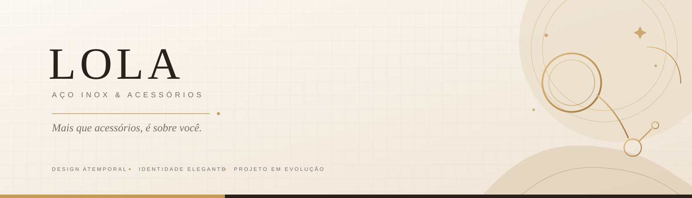

<div align="center">

[](https://github.com/LEVIATAD21/lola_site/actions/workflows/ci.yml)


**Elegância nos detalhes. Uma experiência de compra em construção.**

[Visão geral](#-sobre-o-projeto) · [Telas](#-experiência-da-loja) · [Tecnologias](#-tecnologias) · [Executar localmente](#-como-executar) · [Testes](#-qualidade-e-testes) · [Próximas etapas](#-estado-atual-e-próximas-etapas)

</div>

---

## ✨ Sobre o projeto

**LOLA Aço Inox & Acessórios** é uma experiência de loja virtual para apresentar semijoias e acessórios com uma identidade visual editorial, delicada e sofisticada.

A interface foi construída em torno de uma paleta de **creme, bege, dourado suave e marrom escuro**, com tipografia elegante, fotografias de produto e componentes responsivos. O objetivo é oferecer uma navegação acolhedora, do primeiro contato com a coleção até a revisão da sacola e a demonstração do checkout.

> [!IMPORTANT]
> **Este repositório ainda está em desenvolvimento.** O checkout atual é demonstrativo: não cria um pedido comercial nem realiza cobranças. Os valores de frete e os cupons são exemplos de interface; o estoque existente no servidor ainda usa dados em memória. Não use dados reais de cartão neste protótipo.

## 💎 Experiência da loja

O projeto está organizado em cinco experiências principais, mantendo a mesma identidade visual:

| Experiência | O que apresenta | Implementação |
|---|---|---|
| **01 · Home** | Apresentação da marca, destaques, categorias e benefícios. | [Componentes da Home](src/components) |
| **02 · Categoria / Brincos** | Navegação pelo catálogo, filtros e cartões de produto. | [Página de categoria](src/components/category/EarringsCategoryPage.tsx) |
| **03 · Detalhe do produto** | Galeria, descrição, especificações e opções de compra. | [Página do produto](src/components/product/ProductDetailPage.tsx) |
| **04 · Carrinho** | Revisão de itens, cupons, estimativa de frete e subtotal. | [Página do carrinho](src/components/cart/CartPage.tsx) |
| **05 · Checkout** | Dados de entrega, seleção demonstrativa do pagamento e resumo final. | [Página de checkout](src/components/checkout/CheckoutPage.tsx) |

O **Assistente Lola** funciona como um componente flutuante da experiência, e não como uma tela adicional. O painel administrativo não faz parte do escopo atual.

## 🧭 Funcionalidades presentes

- Navegação entre as cinco experiências da loja.
- Catálogo de demonstração com categorias e recomendações.
- Sacola e favoritos mantidos localmente no navegador.
- Consulta de disponibilidade por meio do serviço de estoque do projeto.
- Validação dos dados de endereço no checkout demonstrativo.
- Aplicação demonstrativa de cupons e estimativa de frete.
- Assistente flutuante com tratamento de indisponibilidade de consulta.
- Verificação de tipos, testes unitários e build configurados no fluxo de CI.

Os itens acima descrevem o que existe na interface e no código; não significam que pagamentos, frete, estoque persistente ou pedidos reais estejam operacionais.

## 🛠️ Tecnologias

- **React** e **TypeScript** — interface e tipagem.
- **Vite** — desenvolvimento e build do frontend.
- **Tailwind CSS** — estilos e responsividade.
- **Lucide React** — ícones.
- **Express** — servidor de desenvolvimento e endpoints demonstrativos em `server.ts`.
- **Vitest** — testes unitários.
- **Google GenAI SDK** — integração opcional da assistente, conforme configuração do servidor.

## 🗂️ Organização do projeto

```text
lola_site/
├── public/
│   └── images/                  # Imagens usadas pela interface
├── docs/
│   └── lola-readme-banner.svg   # Capa visual desta página do GitHub
├── src/
│   ├── components/              # Componentes e telas da loja
│   │   ├── category/             # Categoria de brincos
│   │   ├── cart/                 # Carrinho e cálculo demonstrativo de frete
│   │   ├── checkout/             # Endereço, pagamento e resumo
│   │   └── product/              # Detalhes e compra do produto
│   ├── data/                     # Catálogo e regras demonstrativas de cupons
│   ├── services/                 # Comunicação com APIs
│   ├── utils/                    # Validações e utilitários
│   ├── types.ts                  # Tipos compartilhados
│   ├── App.tsx                   # Navegação e estado principal
│   └── main.tsx                  # Entrada da aplicação
├── server.ts                     # Servidor Express e endpoints demonstrativos
├── package.json                 # Scripts e dependências
├── vite.config.ts                # Configuração do Vite
└── .github/workflows/ci.yml      # Verificação automatizada
```

## 🚀 Como executar

### Pré-requisitos

- Node.js **22 ou superior**.
- npm.
- Git.

### 1. Baixe o projeto

```bash
git clone https://github.com/LEVIATAD21/lola_site.git
cd lola_site
```

### 2. Instale as dependências

```bash
npm ci
```

### 3. Inicie o ambiente local

```bash
npm run dev
```

O servidor de desenvolvimento usa a porta **3000** por padrão. Acesse [http://localhost:3000](http://localhost:3000).

### Variáveis de ambiente

A integração da assistente pode depender de uma chave configurada no ambiente do servidor, como `GEMINI_API_KEY`. Configure segredos somente no ambiente local ou no gerenciador de segredos do serviço de hospedagem. **Nunca inclua chaves privadas no frontend, no repositório ou em variáveis com prefixo público `VITE_`.**

## 🧪 Qualidade e testes

Os comandos disponíveis são:

| Comando | Finalidade |
|---|---|
| `npm run lint` | Verificação de tipos TypeScript (`tsc --noEmit`). |
| `npm test` | Executa os testes unitários com Vitest. |
| `npm run build` | Gera a versão de produção do frontend com Vite. |
| `npm run dev` | Inicia o servidor de desenvolvimento. |

O workflow [GitHub Actions · CI](.github/workflows/ci.yml) executa instalação, verificação de tipos, testes e build para alterações na branch `main` e pull requests direcionados a ela.

> A existência desses comandos e do workflow não garante, por si só, que a última execução passou. Consulte a página de [Actions](https://github.com/LEVIATAD21/lola_site/actions) para conferir os resultados reais.

## 🧩 Estado atual e próximas etapas

### Já preparado no frontend
- Identidade visual consistente entre as cinco telas.
- Estado local de carrinho e favoritos.
- Validação defensiva de dados carregados do armazenamento.
- Tratamento de falha na consulta de estoque.
- Testes unitários para validações, cupons, payloads de estoque e armazenamento do carrinho.

### Necessário antes de vender de verdade
- Persistência real de produtos, preços e estoque.
- Validação definitiva de preço, disponibilidade e cupom no servidor.
- Cotação oficial de frete e prazo.
- Integração com provedor de pagamento.
- Criação de pedidos e confirmação por resposta real do servidor/provedor.
- Revisão final das políticas comerciais, privacidade e conteúdo de produto.

### Princípio de manutenção

O visual aprovado deve evoluir sem redesenho desnecessário: **corrigir primeiro a consistência, confiabilidade, acessibilidade e integração, preservando a identidade LOLA**.

---

<div align="center">

**LOLA Aço Inox & Acessórios**

*Mais que acessórios, é sobre você. ♡*

[Repositório no GitHub](https://github.com/LEVIATAD21/lola_site) · [Commits](https://github.com/LEVIATAD21/lola_site/commits/main) · [Actions](https://github.com/LEVIATAD21/lola_site/actions)

</div>
