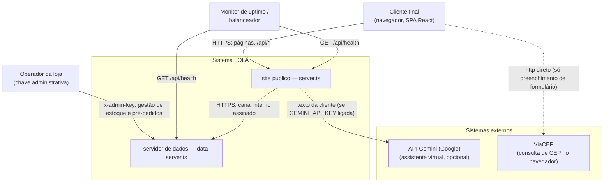
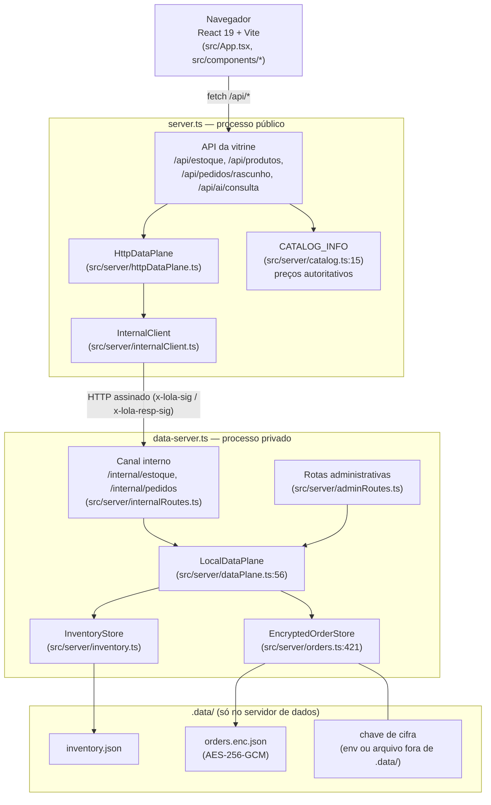
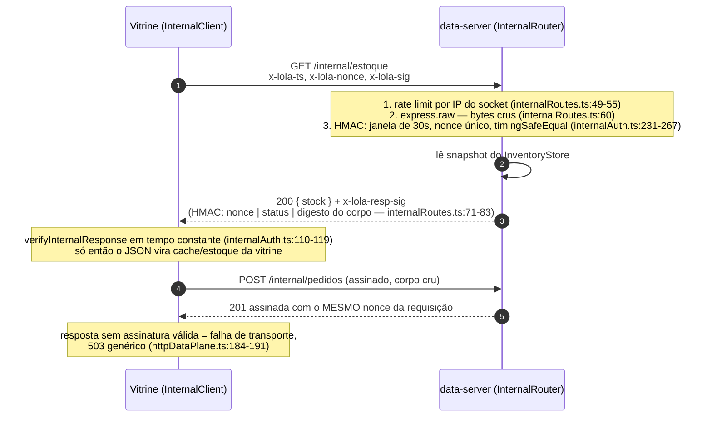

# Arquitetura — LOLA Aço Inox & Acessórios

Este documento é o mapa do sistema. Quem chega hoje consegue entender a loja
inteira por aqui: quem fala com quem, o que cada processo carrega, por onde
passa um pedido e por que a arquitetura é do jeito que é. Referências de código
vêm no formato `arquivo:linha`.

Resumo em uma frase: é uma loja React servida por um processo Express público
(`server.ts`) que, em produção dividida, não tem estoque, não tem pedidos e não
tem chave nenhuma — essas coisas vivem num segundo processo fechado
(`data-server.ts`), alcançável só por um canal HTTP assinado nos dois sentidos.

---

## 1. C4 — Nível 1: contexto do sistema



- **Cliente final** é a única pessoa que usa a loja de verdade: navega, monta
  sacola, consulta estoque e registra pré-pedido.
- **Operador** não tem painel web — fala com as rotas administrativas por
  requisição autenticada com `x-admin-key` (`src/server/adminRoutes.ts:32-135`).
- **Gemini** é opcional e substituível: sem `GEMINI_API_KEY` o assistente cai
  num motor local de regras (`server.ts:500-539`) e nada sai da máquina.
- **ViaCEP** é consultado pelo próprio navegador, no preenchimento do CEP
  (`src/services/cep.ts:18`) — não passa pelo backend.

## 2. C4 — Nível 2: contêineres



O contrato entre os dois mundos é uma interface de dois métodos —
`snapshot()` e `createDraft()` (`src/server/dataPlane.ts:30-38`) — com duas
implementações: `LocalDataPlane` (a autoridade, no processo que tem os
arquivos) e `HttpDataPlane` (o proxy honesto da vitrine). Nenhum handler da
vitrine sabe qual das duas está ativa; a escolha acontece uma vez no boot
(`server.ts:110-146`).

## 3. Os dois modos

O modo de operação é decidido no boot, nunca por requisição
(`server.ts:29-44`): se `LOLA_DATA_SERVICE_URL` estiver definido, o `server.ts`
é só vitrine; senão, ele também é o dono dos dados.

| O que muda | **Embutido** (1 processo) | **Dividido** (2 processos) |
|---|---|---|
| Plano de dados | `LocalDataPlane`, local (`server.ts:126-145`) | `HttpDataPlane` → `InternalClient` (`server.ts:112-124`) |
| Chave de cifra dos pedidos | neste processo | só no `data-server.ts` |
| Rotas administrativas | só se quem opera pedir (`LOLA_EMBEDDED_ADMIN=true`, `server.ts:56`) | só no `data-server.ts` (`server.ts:148-151`, `data-server.ts:139`) |
| Teto de holds por cliente | ativo (o `meta.ip` é o IP da cliente, `server.ts:139-142`) | desligado no data-server (o `meta.ip` seria sempre a vitrine, `data-server.ts:92-95`) |
| Bind e TLS | porta pública atrás do proxy | loopback/privado por padrão, TLS opcional (`data-server.ts:59-73`, `170-180`) |
| Uso típico | desenvolvimento, implantação pequena | produção |

**Por que o modo dividido existe**: o processo público é o que recebe tráfego
de estranhos 24h por dia — é ele que será escaneado, fuzzado e, um dia,
comprometido. Separar garante que comprometer a vitrine não entregue a base de
clientes nem as chaves: lá dentro não há `InventoryStore`, não há
`EncryptedOrderStore`, não há `LOLA_ADMIN_API_KEY` e o prefixo `/internal`
responde 404 de propósito (`server.ts:552-558`). O `docker-compose.yml` formaliza
os dois perfis: `embutido` (`docker-compose.yml:71-73`) e `dividido`, onde o
`data-server` é o único serviço **sem `ports:`** (`docker-compose.yml:151-182`),
alcançável apenas pela rede interna `lola-interna`.

## 4. Fluxo de um pedido — do clique na sacola ao pré-pedido cifrado

```mermaid
sequenceDiagram
    autonumber
    participant C as Navegador
    participant V as server.ts (vitrine)
    participant I as InternalClient
    participant D as data-server.ts
    participant P as LocalDataPlane
    participant O as EncryptedOrderStore

    Note over C: Sacola vive no localStorage (src/utils/cartStorage.ts)
    C->>C: CheckoutPage monta payload SEM preço<br/>(só productId, quantity, variant — src/services/api.ts:141-152)
    C->>V: POST /api/pedidos/rascunho
    Note over V: Middlewares em ordem (ver abaixo)
    V->>I: plane.createDraft(body, {ip})
    I->>D: POST /internal/pedidos (assinado)
    Note over D: rate limit → express.raw → HMAC → assinatura de resposta
    D->>P: createDraft
    P->>P: buildOrderDraft: valida cliente, cupom, itens;<br/>PREÇO vem do catálogo (orders.ts:202)
    P->>P: placeHold: reserva as unidades (inventory.ts:174)
    P->>O: save: cifra AES-256-GCM e grava (orders.ts:627)
    O-->>P: true
    P-->>D: 201 { success, order pública }
    D-->>I: 201 assinada (x-lola-resp-sig)
    I-->>V: resposta autenticada e projetada<br/>(httpDataPlane.ts:98-105)
    V-->>C: 201 com número do pré-pedido
    C->>C: parseDraftOrderConfirmation valida a forma<br/>(src/services/api.ts:169-197) e abre o modal de sucesso
```

**Middlewares da vitrine, nesta ordem** (`server.ts:183-227`):

1. `x-powered-by` desligado (`:183`) e `trust proxy` só com declaração
   explícita (`:186-187`).
2. Cabeçalhos de segurança **antes** do body parser, para JSON malformado
   também ser protegido (`:189-197`).
3. `Cache-Control: no-store` em `/api` (`:198-201`).
4. Log de requisição por pedido de API, sem corpos (`:203`).
5. Guarda anti-CSRF de escrita — compara `Origin` com `Host` — **antes** dos
   rate limits, para site malicioso não queimar o orçamento da vítima
   (`:207`, `src/server/requestGuard.ts:23`).
6. Orçamento bruto por IP **antes** do `express.json`, cobrindo JSON
   malformado e corpo gigante (`:214-219`).
7. `express.json({ limit: '16kb' })` (`:221`).
8. Limite específico do caminho: 10 pré-pedidos/min por IP
   (`limitOrderDraft`, `:223-227`).
9. Só então o handler (`:296-305`): confere que o corpo é objeto e delega ao
   plano de dados.

No servidor de dados a ordem é ainda mais deliberada
(`data-server.ts:119-139`): `/internal` monta `express.raw` e o HMAC
**antes** de qualquer `express.json` — a assinatura cobre os bytes crus, não um
objeto re-serializado (`src/server/internalRoutes.ts:57-65`).

**O que valida o quê** — validação e reserva acontecem só no lado do plano de
dados, nunca na vitrine:

| Etapa | Onde | O que garante |
|---|---|---|
| Forma do corpo | `server.ts:297-299` | objeto, não array |
| Cifra pronta? | `dataPlane.ts:76-78` | sem chave válida → 503 genérico |
| Capacidade | `dataPlane.ts:80-82` | 10.000 registros → 503, não 500 mudo |
| Cliente, termos, formas | `orders.ts:131-166` | texto sem marcação (`:101-109`), telefone 10-11 dígitos, CEP real (`:94-99`), UF válida, `pix`/`boleto` |
| Cupom | `orders.ts:169-179` e `228-238` | existência, validade, mínimo e teto de usos conferido **aqui**, com subtotal em mãos |
| Linhas de produto | `orders.ts:181-209` | 1 a 30 linhas, quantidade inteira 1-99, id existe no catálogo |
| Estoque | `orders.ts:211-221` | saldo suficiente, somando repetições do mesmo produto |
| Reserva atômica | `inventory.ts:174-226` | `placeHold` valida e compromete sem interleave; sem ela, 12 pedidos de 5 unidades passariam todos contra 7 em estoque |
| Persistência | `orders.ts:627-653` | falha de escrita desfaz a reserva (`dataPlane.ts:112-116`) |

**Onde o preço é resolvido: sempre no servidor, contra o catálogo.** O payload
do navegador carrega `productId`, `quantity` e `variant` — e nada mais
(`src/services/api.ts:141-152`, montado em
`src/components/checkout/CheckoutPage.tsx:198-202`). Os totais que a cliente vê
no checkout (`CheckoutPage.tsx:86-92`) são exibição: o pré-pedido é calculado
por `buildOrderDraft`, que busca cada produto em `CATALOG_INFO` e deriva
`unitPriceCents` do preço do catálogo (`orders.ts:202`), aplica cupom, frete e
embalagem (`orders.ts:240-249`) e devolve de volta ao navegador um objeto
reconstruído campo a campo (`src/server/httpDataPlane.ts:98-105`,
`src/services/api.ts:169-197`). Preço vindo do cliente é inexistente por
design: não é ignorado com vergonha, nunca é sequer lido.

`paymentStatus` sai sempre como `not_configured` (`orders.ts:260`): não há
gateway de pagamento. O pré-pedido registra a intenção de compra e o site
orienta a cliente ao atendimento — é o estado real da loja, não um placeholder.

## 5. Canal interno — assinatura nos dois sentidos

O canal máquina-a-máquina liga `server.ts` (vitrine) a `data-server.ts`. Cada
requisição leva quatro cabeçalhos — `x-lola-ts`, `x-lola-nonce`, `x-lola-sig`
(`src/server/internalAuth.ts:31-33`) — e a assinatura é HMAC-SHA256 sobre a
cadeia canônica `versão | timestamp | nonce | método | caminho | digesto do
corpo` (`internalAuth.ts:65-78`). Do lado de lá:



A volta também é assinada porque a rede entre os dois processos não é
confiável por princípio: sem `x-lola-resp-sig`, um atacante nela forjava um
`201` de pré-pedido e a vitrine entregaria à cliente um código de confirmação
que nunca existiu. O nonce amarra a resposta à requisição que a originou; o
`status` entra no HMAC para impedir rebaixar ou inflar o código.

Defesas do lado do chamador (`src/server/internalClient.ts`):

- a URL base vem **só do ambiente** — nunca de header, query ou corpo
  (`internalClient.ts:15-16`);
- **nenhum redirect** é seguido: `redirect: 'error'` (`:202`);
- **HTTP fora de loopback é recusado** sem opt-in explícito (`:143-149`);
- **faixa link-local recusada** (`169.254.x.x`, `fe80::`): um typo de
  configuração ali mandaria o canal com PII para o metadata service da nuvem
  (`:73-85`, `:137-142`);
- timeout abortável e corpo de resposta limitado a 64 kB (`:203-208`);
- resposta validada em forma e reconstruída (`httpDataPlane.ts:51-105`) — a
  vitrine impõe o contrato público ela mesma, sem confiar no vizinho.

Falha fechada em tudo: assinatura inválida, resposta sem assinatura, corpo
fora do contrato → 503 genérico com a mensagem de `PEDIDOS_INDISPONIVEL`
(`src/server/dataPlane.ts:47-54`); o motivo real fica no log do operador.

## 6. Armazenamento

Tudo mora em `.data/` (configurável por `LOLA_DATA_DIR`), e **só o processo
que tem os arquivos cria o plano de dados** (`src/server/dataPlane.ts:152`).

| Arquivo | Conteúdo | Escrita |
|---|---|---|
| `.data/inventory.json` | `productId → { total, reservado, vendido, disponivel }`, em JSON claro (`src/server/inventory.ts:98-108`) | atômica: arquivo temporário + `rename`, modo 0600 em diretório 0700 |
| `.data/orders.enc.json` | array de pré-pedidos dentro de um envelope cifrado (`src/server/orders.ts:610-625`) | idem |
| `.data/orders.key` | chave local, **só em desenvolvimento** (`orders.ts:481-510`) | gerada na primeira subida, 0600 |

**Cifra**: AES-256-GCM, envelope v2 com IV aleatório de 12 bytes por gravação e
AAD fixo (`lola-orders|orders.enc.json`, `orders.ts:346`) que amarra a cifra àquele
arquivo — trocar o `orders.enc.json` por envelope de outro lugar não decifra.
A chave vem, em produção, de `LOLA_ORDERS_ENCRYPTION_KEY` (64 hex) ou de
`LOLA_ORDERS_KEY_FILE` apontando para **fora** de `.data/` — volume de segredo
do Docker/Kubernetes, com permissão 0600 exigida em produção
(`orders.ts:456-477`). O arquivo é cifrado por inteiro, não campo a campo: por
isso `remove()` e `redact()` reescrevem tudo com a chave vigente
(`orders.ts:739-788`) e nunca exigem a chave antiga.

**Retenção**: 90 dias por padrão (`LOLA_ORDER_RETENTION_DAYS`,
`orders.ts:364-377`), purgados na subida e a cada hora
(`dataPlane.ts:179-192`) — retenção é relógio, não "girar o arquivo quando o
disco enche". `0` desliga a expiração, e isso é opt-in explícito.

**Estoque**: o arquivo guarda o saldo contábil; as pré-reservas ficam **só em
memória** (`inventory.ts:44-48`), expiram sozinhas (TTL padrão de 30 minutos,
`server.ts:73` / `data-server.ts:83`) e são varridas a cada minuto
(`dataPlane.ts:195-199`). Reiniciar o processo não perde nem duplica nada:
`disponivel` devolvido ao exterior já é líquido das reservas vivas
(`inventory.ts:136-146`).

**O que não é gravado**, de propósito (`orders.ts:39-53`): cartão/CVV (nunca
são recebidos), e-mail (não há cadastro), `giftWrap` como booleano, IP da
cliente (só mascarado no log, via `LOLA_LOG_IP_MODE`,
`src/server/logger.ts:21-43`) e o corpo cru da requisição. O teto do arquivo é
10.000 registros (`orders.ts:423`), com aviso a partir de 90% — a rotação é
operação, não automação.

## 7. Por que cada escolha arquitetural

**Duas metades com um contrato fino.** A superfície que recebe estranhos e a
que guarda dinheiro/dado pessoal têm ciclos de vida, riscos e públicos
diferentes. `DataPlane` (`dataPlane.ts:30-38`) mantém os dois lados
intercambiáveis sem espalhar `if (modoDividido)` pelos handlers: o modo se
resolve uma vez no boot e nenhum caminho de requisição participa da escolha.

**Preço e estoque autoritativos no servidor.** Tudo que é dinheiro e saldo nasce
contra o catálogo compilado no servidor (`catalog.ts:15`) e o `InventoryStore`.
Confiar em número do navegador transforma o checkout num formulário que a
própria cliente pode editar. A troca é aceitável: o cliente calcula para exibir,
o servidor calcula para valer — e os dois números são o mesmo algoritmo, com o
servidor vencendo.

**Canal assinado nos dois sentidos.** Um token estático basta "enquanto a rede
for privada", que é exatamente o pressuposto que um atacante entre os dois
servidores derruba. Timestamp assinado + nonce único + HMAC sobre método,
caminho e corpo mata replay e adulteração na ida; a assinatura de resposta mata
a forja do `201` na volta. Custo: ~200 linhas de código testadas, zero
dependência externa.

**Falha fechada, resposta genérica.** Chave de pedidos ilegível, assinatura
errada, TLS incompleto → 503 com mensagem única. Diferenciar os motivos na
resposta seria um oráculo de configuração para visitante anônimo
(`dataPlane.ts:41-45`, `adminAuth.ts:8-13`). O operador descobre pelo log e pelo
aviso de subida.

**Arquivo JSON cifrado em vez de banco.** A loja tem um processo, um operador
e um volume. Um SGBD acrescentaria backup, migração e superfície de ataque sem
acrescentar concorrência — as mutações são síncronas de propósito, para
validação e escrita não se intercalarem (`inventory.ts:36-39`). A escolha é
honestamente limitada: cabe 10.000 pré-pedidos e uma instância; quando isso
virar aperto, a porta de saída é um banco transacional atrás da mesma interface
`DataPlane`.

**Painel administrativo nunca na vitrine.** Em modo dividido ele não existe no
processo público — é o ponto da separação (`adminRoutes.ts:11-25`). Nem no
embutido em produção ele aparece sem `LOLA_EMBEDDED_ADMIN=true`
(`server.ts:56`). Duas travas independentes em cada rota: chave comparada em
tempo constante com resposta idêntica para "chave errada" e "chave ausente",
e allowlist de origem que só existe do lado dos dados.

**CORS inexistente no servidor de dados** (`data-server.ts:27-28`): o painel
fala por trás do próprio backend, então a chave administrativa jamais existe
dentro de um navegador — é mais simples nunca emitir CORS do que configurá-lo
certo.

**`stale-if-error` com janela curta no cache de estoque**
(`httpDataPlane.ts:151-160`): queda curta do servidor de dados serve o último
snapshot em vez de derrubar a loja, sem abrir brecha de oversell, porque
validação e reserva continuam autoritativas do outro lado.

**Sem gateway de pagamento — por enquanto.** `paymentStatus: not_configured` é
a assinatura honesta de um sistema que não cobra nada (decisão registrada em
`DECISIONS.md`). Introduzir um PSP muda o fluxo em um ponto só: a etapa que hoje
termina no pré-pedido passaria a redirecionar para a cobrança — e o catálogo de
preços do servidor continua sendo a única autoridade.

---

## 8. Referência rápida

### Arquivos que importam

| Arquivo | Papel |
|---|---|
| `server.ts` | vitrine: SPA, API pública, escolha de modo no boot |
| `data-server.ts` | dados: canal interno + admin, tem os arquivos e as chaves |
| `src/server/dataPlane.ts` | contrato entre os dois + montagem do plano local |
| `src/server/orders.ts` | validação/preço do pré-pedido + armazenamento cifrado |
| `src/server/inventory.ts` | estoque, pré-reservas, baixa |
| `src/server/internalAuth.ts` | HMAC de ida e de volta do canal interno |
| `src/server/internalClient.ts` | chamador do canal (anti-SSRF, anti-redirect) |
| `src/server/internalRoutes.ts` | receptor do canal no servidor de dados |
| `src/server/httpDataPlane.ts` | proxy de estoque/pedido na vitrine, com cache |
| `src/server/adminRoutes.ts` / `adminAuth.ts` | painel: chave + allowlist |
| `src/services/api.ts` | contrato do navegador com a vitrine |

### Variáveis que decidem a topologia

| Variável | Efeito |
|---|---|
| `LOLA_DATA_SERVICE_URL` | definida → modo dividido; vazia → embutido (`server.ts:43-44`) |
| `LOLA_INTERNAL_SECRET` | segredo do canal (mín. 32); sem ele o data-server não sobe (`data-server.ts:51-57`) |
| `LOLA_ORDERS_ENCRYPTION_KEY` / `LOLA_ORDERS_KEY_FILE` | chave de cifra dos pedidos em produção |
| `LOLA_DATA_DIR` | onde ficam `inventory.json` e `orders.enc.json` |
| `LOLA_ADMIN_API_KEY` (mín. 32) / `LOLA_ADMIN_ALLOWED_IPS` | painel administrativo |
| `LOLA_ORDER_RETENTION_DAYS` | retenção dos pré-pedidos (padrão 90) |
| `LOLA_RESERVATION_TTL_MS` | janela da pré-reserva de estoque (padrão 30 min) |
| `LOLA_EMBEDDED_ADMIN` | permite o painel no processo público em produção embutida |
| `GEMINI_API_KEY` | assistente no modelo externo; vazia → motor local, nada sai da máquina |
